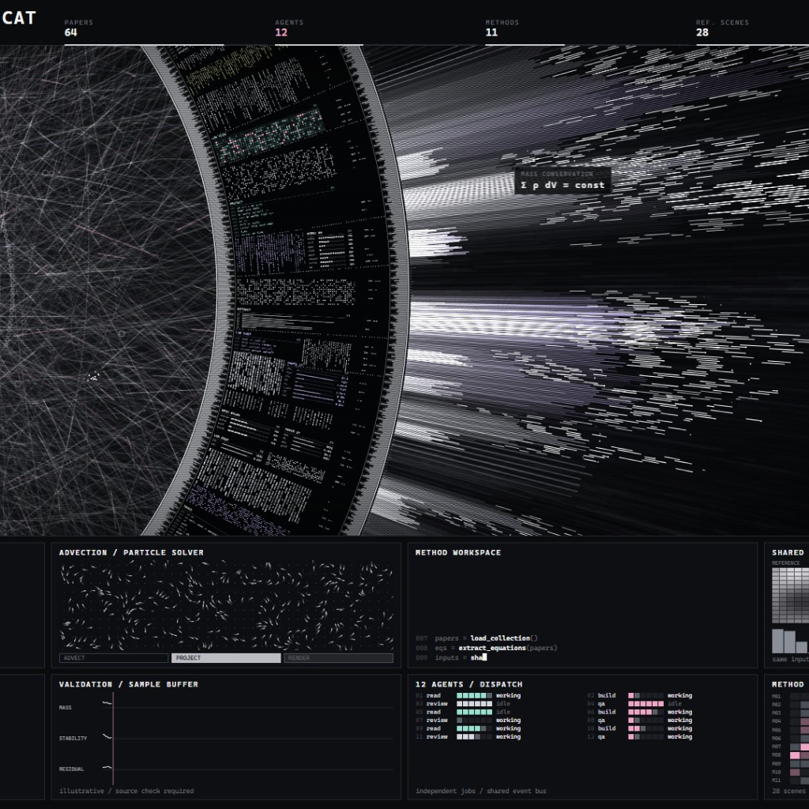

# HaloFlux for macOS

**A live desktop halo for your AI Agents.**

A macOS adaptation of **[HALOFLUX by Ryder191 (RYDER CODE / Ms MAIKEBAIs CAT)](https://github.com/Ryder191/haloflux)**. It preserves the original particles, light beams, and detailed ring, and connects them to real workspace activity through **Orca's local CLI**. Wallpaper Engine is not required.

[Download v0.1](https://github.com/SHOCKY47/haloflux-mac/releases/tag/v0.1) · [中文](README.md) · [Integration details](docs/ORCA-INTEGRATION.md)

> **Noncommercial use only.** Source is available under the original PolyForm Noncommercial 1.0.0 license and accompanying notices. This is not a permissive MIT/Apache or OSI open-source release. Read [LICENSE](LICENSE).



*Original visual reference from [HALOFLUX by Ryder191](https://github.com/Ryder191/haloflux), not a screenshot of live Agent data. The macOS port uses this artwork with Orca-driven headings and panels.*

## What you see

| State | Desktop behavior |
| --- | --- |
| Agent working | Original particle and beam effects, reported model, tool activity, and Agent states |
| Several active workspaces | Up to four workspaces, rotating every 15 seconds with smooth color changes |
| One active workspace | Stays on that workspace |
| Question or approval pending | Inner and outer barcode ticks breathe in the workspace color |
| No active tasks | Complex effects stop; a slow ring rotates across four standby scenes |
| Orca unavailable | Standby scenes with unavailable status; stale activity is cleared |

White particles retain the original look. Accents use the original lavender, red `#F03E3E`, blue `#5C7CFA`, and green `#2F9E44`. Default workspace names are **Moonshot Lab**, **Deep Thought**, **Quiet Orbit**, and **Coffee Break**.

The wallpaper sits behind desktop icons and passes mouse input through. A black top inset accommodates the menu bar and camera notch. UI text is English; actual workspace and folder names retain their original text.

## Quick install

**Apple Silicon (M-series), macOS 13+.** The minimum OS is a build target, not a claim that every macOS version has been tested. v0.1 binaries are arm64 only.

1. Download **`HaloFlux-v0.1-macOS-arm64.zip`** from the [v0.1 release](https://github.com/SHOCKY47/haloflux-mac/releases/tag/v0.1), rather than GitHub's automatic source archives.
2. Extract it and double-click **`Install.command`**.
3. Look for **◉** in the menu bar. The wallpaper starts and is configured to launch at future GUI logins.
4. Open Orca and start a task. Connection is automatic. Orca is optional for standby visuals.

The prebuilt installer needs **no Xcode, Python, Node.js, administrator access, or model API key**. It installs to `~/Applications/HaloFlux.app`, with previous installations retained under `~/Library/Application Support/HaloFlux/Backups/`.

### First-launch approval

v0.1 is **ad-hoc signed, not Developer ID signed or Apple-notarized**. macOS may block a downloaded copy. If you trust the download, follow [Apple's instructions](https://support.apple.com/en-us/102445): try opening it, then use **System Settings → Privacy & Security → Open Anyway**. The installer does not remove quarantine attributes or disable Gatekeeper.

If the `.command` launcher is blocked, type `bash ` in Terminal, drag the extracted `install.sh` into Terminal, and press Return. The installed app still requires any first-launch approval requested by macOS.

## Controls

The **◉** menu contains **Show Desktop Animation**, **Preview Animation**, **Animation Speed** (25% by default, also 50% and 100%), **About HALOFLUX**, and **Quit HALOFLUX**. Quit ends this run; it does not disable launch at login. Closing the app reveals the previous system wallpaper.

The wallpaper pauses its own rendering and polling when the screen locks or sleeps. It never stops or controls your Agents.

## Orca connection

This is an unofficial integration with the macOS Agent/workspace application identified as `com.stablyai.orca`.

- Install Orca's CLI using Orca's CLI installation feature.
- With Orca running, `orca worktree ps --limit 10000 --json` should return `ok: true` and a workspace list.
- The app looks for `/usr/local/bin/orca`, then `/opt/homebrew/bin/orca`.
- For a custom executable, run `defaults write local.haloflux.desktop orcaCLIPath -string "/absolute/path/to/orca"` and restart HaloFlux. Remove the override with `defaults delete local.haloflux.desktop orcaCLIPath`.

The integration reads local status and matching session metadata. Codex asynchronous-question detection also reads bounded portions of matched session logs. It forwards request flags, not question text or tool arguments, to the renderer. Nothing is uploaded by HaloFlux. Workspace names, paths, branches, short task titles, and tool names are displayable metadata; consider them when sharing screenshots.

Model and request detection depend on available Orca/Agent metadata and may need updates as their formats change. Missing models fall back to client names; unsupported requests do not produce guessed alerts. See [architecture, data access, and compatibility](docs/ORCA-INTEGRATION.md).

## Update, remove, or build

- **Update:** run the new release's installer. The previous app is backed up.
- **Uninstall:** run `Uninstall.command`. It removes the login job and moves the app to Trash, retaining backups and preferences.
- **Disable launch at login only:** `launchctl disable "gui/$(id -u)/local.haloflux.desktop.login"`. Running the installer enables it again.

Build on macOS with Xcode Command Line Tools:

```sh
git clone https://github.com/SHOCKY47/haloflux-mac.git
cd haloflux-mac
bash build.sh
bash install.sh
```

To create the release ZIP and checksum file, run `bash scripts/package-release.sh`. See [CONTRIBUTING.md](CONTRIBUTING.md).

## Scope and limitations

- **Desktop wallpaper only.** No lock-screen videos, wallpaper extensions, or screen savers are included.
- Tool panels may be empty without real tool activity. Default workspaces are intentional standby scenes, not simulated tasks.
- Pending-question cues require confirmed request evidence; generic waiting or unread states do not trigger them.
- Original particles can use significant GPU resources, particularly on multiple or high-resolution displays. Slower motion is not a frame-rate cap.
- Apple Silicon is the only packaged architecture. Compatibility across every macOS and Orca version has not been established.

## Credits

**Original work: HALOFLUX by Ryder191 (RYDER CODE / Ms MAIKEBAIs CAT)**  
**Original project: https://github.com/Ryder191/haloflux**

Thank you to Ryder191 for sharing the animation and its intricate visual design. This independent adaptation adds a native macOS desktop host, Orca status mapping, workspace rotation, and reply indicators. The original artwork is credited to its creator; this project is not endorsed by Ryder191 or Orca.

The complete original [LICENSE](LICENSE), source notices, and [NOTICE](NOTICE) are preserved. Use and sharing must follow their noncommercial and attribution requirements. Credit and link the original when publishing derivatives, screenshots, or videos.

Bundled music: **Synthwave 421k** by The Cynic Project / cynicmusic, CC0. Music is disabled in the desktop app by default.
