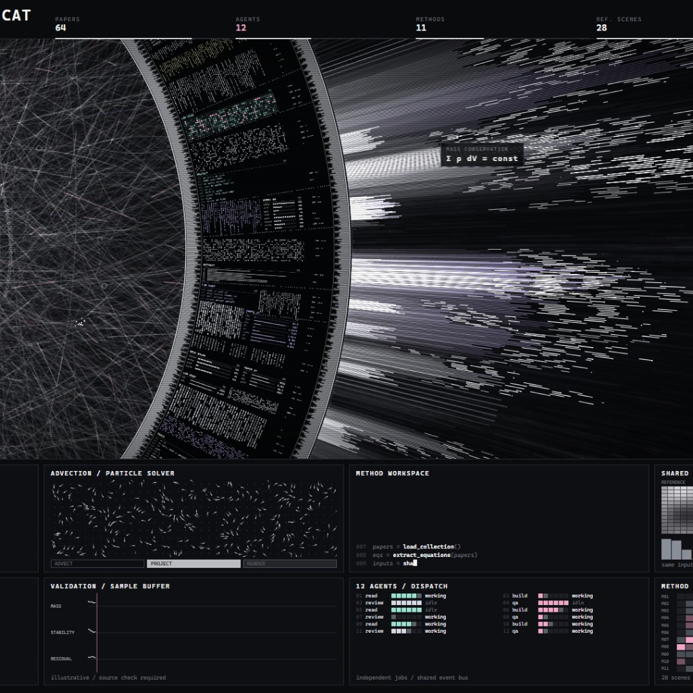

# HaloFlux for macOS

**让桌面上的光环，跟着你的 AI Agent 一起工作。**

基于 **[HALOFLUX by Ryder191（RYDER CODE / Ms MAIKEBAIs CAT）](https://github.com/Ryder191/haloflux)** 修改的 macOS 动态桌面壁纸。保留原作的粒子、光束和精细圆环，通过 **Orca 的本地 CLI 接口**显示真实的工作区和 Agent 状态。无需 Wallpaper Engine。

[下载 v0.1](https://github.com/SHOCKY47/haloflux-mac/releases/tag/v0.1) · [English](README.en.md) · [Orca 接入说明](docs/ORCA-INTEGRATION.md) · [许可证](LICENSE)

> **仅限非商业使用。** 本项目沿用原作的 PolyForm Noncommercial 1.0.0 及附加声明，公开源码，但不是 MIT / Apache 等允许商用的开源许可。请先阅读 [LICENSE](LICENSE)。



*上图是随原素材保留的视觉参考，来源：[HALOFLUX by Ryder191](https://github.com/Ryder191/haloflux)。macOS 版沿用这套动画，运行时的标题和面板由 Orca 状态驱动；上图不是实时 Agent 数据截图。*

## 它能做什么？

| Agent 状态 | 桌面表现 |
| --- | --- |
| 正在工作 | 原版粒子与光束运动，显示实际模型、工具和主 / 子 Agent 状态 |
| 多个工作区在工作 | 最多显示 4 个，每 15 秒切换一次，配色平滑过渡 |
| 只有一个工作区在工作 | 固定展示该工作区，不轮播空页面 |
| 需要你回答问题或确认 | 对应页面内外两圈的条码刻度同步呼吸，提示回复 |
| 没有任务在工作 | 粒子淡出，圆环缓慢待命；轮播 4 个默认工作区 |
| Orca 未启动或连接不可用 | 显示默认待命画面，不伪造任务，也不沿用过期状态 |

四色包含原作紫色，以及红色 `#F03E3E`、蓝色 `#5C7CFA`、绿色 `#2F9E44`。主要粒子保持白色，通过边缘、部分字符和界面强调色区分工作区。

默认工作区：**Moonshot Lab · Deep Thought · Quiet Orbit · Coffee Break**。

壁纸位于桌面图标后方，不拦截鼠标。菜单栏顶部预留黑色空间，适配菜单栏和刘海。界面使用英文，真实工作区和文件夹名称保留原文。

## 快速安装

**需要：Apple Silicon Mac（M 系列），macOS 13 或更新版本。** v0.1 提供 arm64 安装包；最低系统版本是编译目标，未在每个 macOS 版本上逐一验证。

1. 从 [v0.1 Release](https://github.com/SHOCKY47/haloflux-mac/releases/tag/v0.1) 下载 **`HaloFlux-v0.1-macOS-arm64.zip`**。不要把 GitHub 自动生成的 `Source code` 当成安装包。
2. 解压到本地文件夹，双击 **`Install.command`**。
3. 安装后，在菜单栏找到 **◉**。壁纸会启动，并在以后每次登录 Mac 时自动启动。
4. 打开 Orca，开始一个 Agent 任务，壁纸会自动连接。没有 Orca 时也能显示待命动画。

安装包已包含编译好的应用。**安装不需要 Xcode、Python、Node.js、管理员权限或模型 API Key。** 安装到 `~/Applications/HaloFlux.app`；旧版本保存在 `~/Library/Application Support/HaloFlux/Backups/`。

### 首次打开被 macOS 拦截？

v0.1 使用临时代码签名（ad-hoc），**未使用 Developer ID 签名，也未经过 Apple 公证**。首次下载可能会被拦截。确认下载来源后，按 Apple 的说明到 **系统设置 → 隐私与安全性 → 仍要打开（Open Anyway）**，再打开安装后的应用。[Apple 官方说明](https://support.apple.com/en-us/102445)

若 `.command` 文件本身无法启动，也可以打开终端，输入 `bash `，将解压文件夹里的 `install.sh` 拖入终端，再按回车。随后仍需按系统提示允许应用首次打开。安装器不会移除隔离标记或关闭系统安全检查。

### 日常操作

点击菜单栏 **◉**：

- **Show Desktop Animation**：显示桌面壁纸。
- **Preview Animation**：在普通窗口中预览。
- **Animation Speed**：选择 25%、50% 或 100%，默认 25%。
- **About HALOFLUX**：查看版本、原作者和原项目链接。
- **Quit HALOFLUX**：退出本次运行，下次登录仍会启动。

退出应用后原有系统壁纸会重新露出。应用在锁屏或显示器休眠时暂停自身动画与状态读取；不会控制 Agent 的运行。

## 连接 Orca

这里的 Orca 是本地运行 Agent、终端和工作区的 macOS 应用（`com.stablyai.orca`）。这是社区适配，不是 Orca 官方插件。

1. 安装并打开 Orca，并使用 Orca 提供的 CLI 安装功能安装命令行入口。
2. 在终端运行 `orca worktree ps --limit 10000 --json`，应返回 `ok: true` 和工作区列表。
3. 启动任务即可。应用会检测 Orca 的启动和退出，不需要手动重连。

默认寻找 `/usr/local/bin/orca` 或 `/opt/homebrew/bin/orca`。自定义位置可执行以下命令，然后退出并重开 HaloFlux：

```sh
defaults write local.haloflux.desktop orcaCLIPath -string "/absolute/path/to/orca"
```

恢复自动寻找：

```sh
defaults delete local.haloflux.desktop orcaCLIPath
```

**数据在本机处理。** 应用调用只读 CLI，并读取匹配当前会话的本地元数据，用于补充模型和待回复状态。Codex 异步提问检测还会读取该会话的部分日志事件；不会把提问正文、工具参数或对话内容交给壁纸渲染器，也不上传到服务器。工作区名称、路径、分支、简短任务标题和工具名称属于可显示的元数据，截图前请留意这些内容。

模型缺失时显示实际客户端名称，不猜测模型。待回复检测依赖 Orca / Agent 版本和可用元数据，无法保证覆盖所有客户端。详见 [数据来源、兼容性与隐私](docs/ORCA-INTEGRATION.md)。

## 更新与卸载

- **更新**：下载新安装包，再运行 `Install.command`。安装器停止旧版并保留备份，然后替换应用和登录任务。
- **卸载**：双击安装包里的 `Uninstall.command`。它移除登录任务，将应用移入废纸篓；保留偏好设置和历史备份。
- **仅取消开机启动**：在终端运行 `launchctl disable "gui/$(id -u)/local.haloflux.desktop.login"`。重新运行安装器可恢复。

## 从源码构建

需要 macOS 和 Xcode Command Line Tools（可通过 `xcode-select --install` 安装）。

```sh
git clone https://github.com/SHOCKY47/haloflux-mac.git
cd haloflux-mac
bash build.sh
bash install.sh
```

构建产物为 `build/HaloFlux.app`。生成可分发的 ZIP 和 SHA-256 校验文件：

```sh
bash scripts/package-release.sh
```

代码结构及参与方式见 [CONTRIBUTING.md](CONTRIBUTING.md)。

## 常见问题

**为什么一直是四个默认页面？**

没有 Agent 在工作或等待你回复时，这是正常的待命状态。如果已有任务在运行，请检查 Orca 是否已打开、CLI 是否可用，以及它是否支持上面的 JSON 命令。读取失败会显示连接不可用，不会生成假任务。

**工具活动面板空着正常吗？**

它依赖实际工具调用和状态更新。待命时可能为空；主 / 子 Agent 面板只显示 Orca 实际报告的 Agent，不会凑满展示行数。

**是不是所有“等待”都会闪灯？**

不是。只有确认属于当前 Agent 的问题或审批才会提示。等待子任务、普通空闲、未读消息不会独立触发；不支持的请求格式也可能无法识别。

**为什么高分辨率屏幕会占用 GPU？**

它实时绘制原版复杂粒子。默认速度为 25%，任务结束后关闭复杂效果；减慢速度不等于限制帧率。多个显示器会各自绘制一份场景。

**支持锁屏、屏保或 Intel Mac 吗？**

v0.1 只发布桌面壁纸，**不包含锁屏视频、锁屏扩展或屏保**。当前预编译包仅面向 Apple Silicon，未提供 Intel 支持承诺。

## 致谢与许可

**原作：HALOFLUX by Ryder191（RYDER CODE / Ms MAIKEBAIs CAT）**  
**原项目：https://github.com/Ryder191/haloflux**

感谢 Ryder191 创作并分享这套精细的粒子、光束和圆环视觉。这个项目是在原作基础上制作的 macOS 适配，新增原生桌面承载、Orca 状态映射、工作区切换与待回复提示；原始动画和视觉设计归原作者所有。本项目独立维护，不代表原作者或 Orca 官方。

完整保留 [原始 LICENSE](LICENSE)、源码版权声明和 [NOTICE](NOTICE)。本项目仅允许原许可范围内的非商业使用；发布衍生版本、截图或视频时，请按原许可要求同时注明原作者与原项目链接。

原作附带音乐为 The Cynic Project / cynicmusic 的 **Synthwave 421k**，采用 CC0；桌面应用默认关闭音乐。

