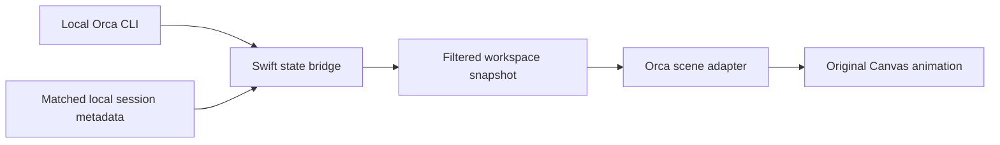

# Orca integration

HaloFlux is an unofficial, read-only client of Orca's local CLI and session metadata. It neither starts Agents nor sends terminal input. The app uses the original HALOFLUX renderer rather than replacing it with a new dashboard.

## Data flow



| Layer | File | Responsibility |
| --- | --- | --- |
| Native host | `Sources/HaloFluxDesktop.swift` | Desktop windows, menu, display geometry, Orca lifecycle, lock/sleep pause |
| Web host | `Sources/HaloWebView.swift` | Local resources in a nonpersistent WKWebView |
| Snapshot bridge | `Sources/OrcaStateBridge.swift` | CLI polling, cancellation, state filtering, delivery to the renderer |
| Model enrichment | `Sources/OrcaModelMetadata.swift` | Verified model identity when absent from CLI output |
| Request enrichment | `Sources/OrcaAttentionMetadata.swift` | Confirmed questions and approvals for exact Agent sessions |
| Scene adapter | `orca-scene.js`, `orca-scene.css` | Workspace selection, panels, activity, palette, reply cue |
| Original artwork | `index.html`, `wp.js` | HALOFLUX scene, modified from Ryder191's original |
| Palette | `workspace-palette.js` | Four colors and 15-second rotation interval |

## Main interface

```sh
orca worktree ps --limit 10000 --json
```

The adapter expects an envelope containing `ok: true` and `result.worktrees`. It reads workspace identity and names, main-Agent state, observed subagents, tool names, timestamps, and explicit outcomes. See the normalized [JSON schema](orca-state.schema.json).

The app polls every 1.8 seconds on a utility queue, with one subprocess at a time, a six-second timeout, and a 16 MiB stdout cap. A failed, truncated, or incompatible result clears the scene's live observations. Raw stderr is discarded. Late callbacks from canceled generations are ignored.

Orca application launch and exit are observed through `NSWorkspace`, using bundle identifier `com.stablyai.orca`. No CLI calls are made while Orca is unavailable. Locking or sleeping the display suspends HaloFlux's polling and rendering; it does not pause actual Agents.

Finder and login launches need not inherit the interactive shell PATH. The app checks `/usr/local/bin/orca` and `/opt/homebrew/bin/orca`. The `orcaCLIPath` preference accepts an absolute executable path. An invalid explicit override fails as unavailable instead of selecting a different CLI.

## Optional local enrichment

These files are **Orca/Agent implementation details**, not a promised stable public API. Their absence or schema changes can disable enrichment while basic CLI activity remains available.

| Local source | Purpose | Access |
| --- | --- | --- |
| `~/Library/Application Support/orca/agent-hooks/last-status.db` | Bind workspace, pane, client, session, model, request metadata | Read-only SQLite queries with a field whitelist |
| Matching account `home/state_5.sqlite`, or `~/.codex/state_5.sqlite` | Confirm session model and child ancestry | Read-only, exact session/path binding |
| Matching session rollout JSONL under that account's `home/sessions/` or `~/.codex/sessions/` | Detect unanswered Codex async questions | Bounded incremental reads of verified session events |

No credential file or provider configuration is read. Model lookup alone never reads rollout content. Request detection does parse selected rollout records, which can contain conversation and tool content, to identify questions and actual user replies. Only Boolean request flags and `question` / `approval` kinds are projected; record bodies, question text, and tool arguments are not retained in the scene payload or written to HaloFlux logs.

Workspace names, paths, branches, model identifiers, short task titles, tool names, and Agent states are displayable metadata. These may themselves be sensitive. HaloFlux has no telemetry or remote data service; its explicit About link opens the upstream GitHub page in the default browser when clicked. The optional `--diagnose-dir` developer flag writes local snapshots and metadata, so diagnostic output should not be published without review.

### Model identity

Prefer the model field from the exact Agent. Fallback metadata must match workspace ID, full pane key, client, provider session ID, and the account-specific recorded rollout path. `auto`, `default`, absent, or unverified values are not model identities. A client name such as `codex` never implies a particular GPT version.

### Pending questions and approvals

- Blocking requests require an explicit prompt or request event and a waiting/blocked owning Agent.
- A Codex `request_user_input_async` tool returns immediately, so a working or ended Agent can still need a human reply. A verified request persists until real user input or interruption.
- Ordinary tool completion, compaction, Agent-to-Agent messages, and normal turn completion do not resolve a human question.
- Observed Codex children require exact same-account thread ancestry and matching rollout headers. Each child has a separate cursor; a parent's answer does not clear another child's request.
- Scanning begins with an 8 MiB tail and follows appended events. Older boundaries are found in bounded chunks, with a 16 MiB aggregate per-poll budget and 1 MiB record limit. Identity changes and truncation reset the cursor. Historical partial reads are not published as current requests.
- Generic waiting, unread activity, and a tool name alone do not imply a question. Unsupported or unreadable metadata produces no confirmed cue.

## Scene rules

Eligible workspaces have a working Agent or confirmed pending human request. Pending requests take priority when selecting up to four workspaces. One eligible workspace stays on screen; two to four rotate every 15 seconds. A newly pending workspace receives focus once. Repeated polls do not continually steal focus.

When none are eligible, the four named default scenes rotate with zero invented Agents. Standby keeps the original detailed ring slowly rotating and stops the complex particles. A pending request colors and pulses the existing inner and outer barcode ticks on a four-second wall-clock cycle, independent of animation speed. Answers or unavailable source data clear that cue.

The `AGENT / TOOL ACTIVITY` panel derives activity from observed updates and tool names, not tool-output replay. `MAIN / SUB AGENTS` displays the actual Agent roster reported by Orca. Empty states are intentional.

## Compatibility boundary

v0.1 packages the macOS desktop implementation developed with the author's local Orca setup. No minimum Orca release number has been established. The practical prerequisite is the JSON command above plus compatible local metadata for optional enrichment. All clients exposing CLI state can contribute basic activity; advanced model/request detection is not guaranteed for every provider or client.

If an Orca update changes behavior, report the macOS version, Orca version, error code shown by the scene, and a description. Redact workspace names, account IDs, paths, and task titles. Do not upload raw databases or conversation transcripts.

